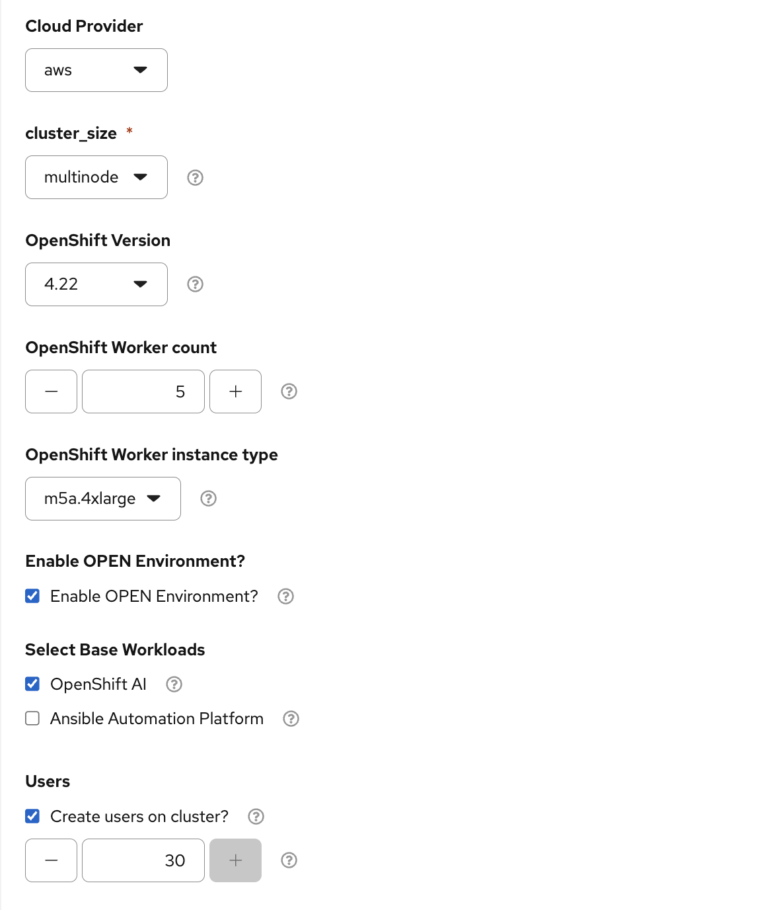
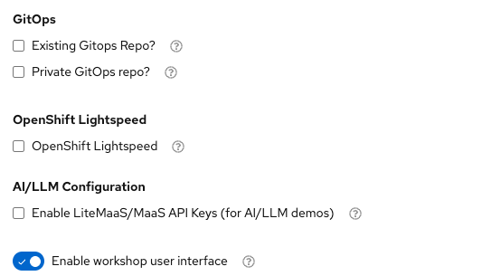

# Environment Setup (Instructors)

How to prepare a cluster for the [Model Deployment and Models-as-a-Service workshop](RHOAI-MODEL-DEPLOYMENT-WORKSHOP.md), for any number of attendees.

You order a cluster from the Red Hat Demo Platform (RHDP), then run **one script** from your laptop. The script does the rest and tells you what is ready. You don't need to know OpenShift well. If you can copy and paste commands into a terminal, you can do this.

**Time:** about 1 hour of setup (mostly waiting), plus 30 minutes for a dry run. Do it the day before the workshop.

**The only real limit is GPUs.** Every attendee deploys their own model on one GPU. With 20 attendees you need 20 GPU nodes. The script adds them for you, as long as the cluster's AWS account allows it (see [Step 1](#step-1-order-the-environment)).

## The short version

1. [Order the environment](#step-1-order-the-environment) on RHDP and wait until it's ready.
2. On your laptop, [log in and clone this repo](#step-2-prepare-your-terminal-once).
3. [Run the setup script](#step-3-run-the-setup-script):

   ```bash
   bash manifests/instructor/setup-workshop.sh --users 20
   ```

4. [Do a dry run](#step-4-dry-run) as one test user, then clean it up.
5. On the [workshop day](#step-5-workshop-day), share the handout the script printed.
6. [Afterwards](#after-the-workshop-clean-up), clean up or delete the environment.

Your cluster's web address is different for every workshop, and that's fine. The attendee guide never contains it. Attendees get the dashboard link from you (the script prints it), and every other address in the guide is read from the cluster by a command.

---

## How many attendees can I run?

| Attendees | GPU nodes (1 GPU each) | Worker count to order | GPU vCPU used | Needs "OPEN Environment"? |
|-----------|------------------------|-----------------------|---------------|---------------------------|
| 5 | 5 | 3 | 40 | No |
| 10 | 10 | 3 | 80 | **Yes** |
| 15 | 15 | 4 | 120 | **Yes** |
| 20 | 20 | 4 | 160 | **Yes** |
| 25 | 25 | 5 | 200 | **Yes** |
| 30 (RHDP maximum) | 30 | 5 | 240 | **Yes** |

- **GPU nodes:** one per attendee. Add one if you want your own demo model (for example in Part 3.1). Each GPU node is a `g6.2xlarge` (1 NVIDIA L4, 8 vCPU) and costs about $1 per hour on demand, so scale them to 0 when you're done.
- **Worker count** = 2 + 1 per 10 attendees, rounded up. Two workers' worth runs the OpenShift AI platform. Each attendee adds about 1 CPU and 2 GiB (Open WebUI, Web Terminal, Playground). Models run on the GPU nodes, not on these workers.
- **GPU vCPU used** counts against AWS's limit for G and VT instance types. Without the OPEN environment that limit can be 64 vCPU, which is only 8 GPU nodes.

**Not enough GPUs?** Pair attendees up. Give each pair one user account and set `--users` to the number of pairs.

---

## Step 1: Order the environment

Order **Field Sourced Content - OpenShift (Shared Clusters)** from the [Red Hat Demo Platform](https://demo.redhat.com) with these settings:



| Field | Value | Notes |
|-------|-------|-------|
| Cloud Provider | `aws` | |
| cluster_size | `multinode` | Not SNO. |
| OpenShift Version | `4.22` | |
| OpenShift Worker count | From the [table above](#how-many-attendees-can-i-run) | The script adds workers if you order too few, but ordering the right number is quicker. |
| OpenShift Worker instance type | `m5a.4xlarge` | 16 vCPU, 64 GiB. The table assumes this type. |
| Enable OPEN Environment? | **checked** | Needed for more than 8 GPU nodes. See the note below. |
| Select Base Workloads | **OpenShift AI** checked, Ansible Automation Platform unchecked | |
| Create users on cluster? | checked, your number of attendees | Creates `user1`..`userN`. 30 is the maximum. |

> **Why "OPEN Environment" matters.** Without it, AWS can limit G and VT instance types (the GPU nodes) to 64 vCPU in total. Each GPU node uses 8, so you'd get at most 8 GPU nodes. Extra GPU machines then stay in `Provisioning` or `Failed` with a quota error. The `m5a.4xlarge` workers are a different type and don't count toward this limit.

Then turn on the workshop user interface. Leave GitOps, Lightspeed and **LiteMaaS** unchecked: this workshop uses OpenShift AI's own Models-as-a-Service, which the script sets up.



| Field | Value | Notes |
|-------|-------|-------|
| Enable workshop user interface | on | Gives attendees a page where they get their user name and password. |
| Registration | `open` | Attendees register themselves. |

RHDP emails you when the environment is ready. Its service page shows what you need next:

- the **OpenShift Console** URL
- the **admin** user name and password (for you only)
- the **user** password (for attendees)

---

## Step 2: Prepare your terminal (once)

Use a terminal on your own laptop: macOS, Linux, or WSL on Windows. **Don't use the OpenShift Web Terminal** for setup: the setup briefly restarts the cluster's networking, which can cut the Web Terminal off part-way.

1. **Install the `oc` command** if you don't have it. In the OpenShift Console, click the **?** icon (top right) > **Command Line Tools** and download it for your laptop. On macOS you can also run `brew install openshift-cli`. Check it works:

   ```bash
   oc version --client
   ```

   You also need `git`, `curl` and `python3`. macOS and most Linux systems already have them.

2. **Log in as the admin user.** Open the OpenShift Console and log in with the admin user from the RHDP page. Click your user name (top right) > **Copy login command** > **Display Token**. Copy the line that starts with `oc login --token=...` and paste it into your terminal. Check it worked:

   ```bash
   oc whoami
   ```

   It should print your admin user name. The login lasts about a day; if a later command says you're not logged in, copy the login command again.

3. **Get this repo:**

   ```bash
   git clone -b rhoai-3.5-maas-workshop https://github.com/cbtham/Red-Hat-AI-Workshop.git
   cd Red-Hat-AI-Workshop
   ```

   Run every command in this guide from this folder.

---

## Step 3: Run the setup script

**First, look without changing anything.** This is read-only and takes a few seconds:

```bash
bash manifests/instructor/setup-workshop.sh --check
```

It lists each part of the setup as `[OK]` or `[!!]`, with a `fix:` line for each problem. On a new cluster most lines are `[!!]`. That's expected.

**Then set it up.** Replace `20` with your number of attendees:

```bash
bash manifests/instructor/setup-workshop.sh --users 20
```

The script shows a plan (how many workers and GPU nodes it will add) and asks `Start? [y/N]`. Type `y` and press Enter. Then leave it running for 45 to 60 minutes. You don't need to answer anything else.

> **Keep your laptop awake.** If the laptop sleeps, the terminal disconnects. On macOS, put `caffeinate -i` in front: `caffeinate -i bash manifests/instructor/setup-workshop.sh --users 20`.

**If it stops part-way** (an error, a timeout, or a dropped connection), run the **same command again**. The `[STOP]` line says what went wrong and names the step's log in `setup-logs/`. Every step is safe to repeat: finished parts are skipped or re-applied without harm.

**When it finishes**, it prints the same `[OK]`/`[!!]` table and an **attendee handout**:

```
=== Attendee handout (share this, not the admin login) ===
  OpenShift AI dashboard : https://<dashboard address for this cluster>
  OpenShift Console      : https://console-openshift-console.apps.<cluster-domain>
  Log in with            : rhbk
  Username               : user1 ... user20 (one per attendee)
  Password               : the user password on your RHDP service page
  Workshop guide         : https://github.com/<fork>/blob/<branch>/RHOAI-MODEL-DEPLOYMENT-WORKSHOP.md
```

The model image pre-pull (last line of the table) keeps running after the script ends. It takes about 15 minutes per GPU node. Check again later with `--check`.

### Options

| Option | What it does |
|--------|--------------|
| `--users N` | Attendees `user1`..`userN`. Default: every `userN` that RHDP created. |
| `--gpus N` | GPU nodes to have ready. Default: same as `--users`. Use `--users 20 --gpus 21` for a demo model of your own. |
| `--check` | Read-only status. Changes nothing. |
| `--skip-platform` | Skip the two long platform scripts. Use it when re-running after they already finished. |
| `--no-wait` | Don't wait for the GPU nodes at the end. |
| `--yes` | Don't ask `Start?`. Needed when running in the background (see [Troubleshooting](#troubleshooting)). |
| `--cleanup` | After the workshop. See [Clean up](#after-the-workshop-clean-up). |

**More attendees than planned?** Run it again with the bigger `--users`. It only adds; it never removes nodes.

### What the script does

| Step | What | Done by | Time |
|------|------|---------|------|
| 1 | Gives every Keycloak user `cluster-admin` and adds them to `rhods-admins`, so attendees can create their own MaaS subscription | `setup_workshop_users_rbac.sh` (reused) | Seconds |
| 2 | Adds CPU workers, only if you have fewer than recommended | `spin-up-workernodes.sh --workers <n> --no-wait` (reused) | 5-10 min, in the background |
| 3 | Creates a GPU MachineSet and the `gpu-profile` hardware profile, renames the profile to plain `gpu-profile` (the name the guide uses), then scales the GPU MachineSet up to `--gpus` | `gpu_machineset_hardwareprofiles.sh` (reused), then this script | 15-20 min per GPU node, in the background |
| 4 | Installs the operators (including the NVIDIA GPU Operator), turns on all OpenShift AI features and the MaaS gateway, installs Connectivity Link, then sets up MaaS (database, auth, rate limits) | `field-source-enable-all-features-35.sh`, then `field-source-setup-maas-35.sh` (reused) | 20-40 min |
| 5 | Workshop add-ons: the inference gateway for Part 3, the Web Terminal operator, the shared OpenShift MCP Server for Part 4.4, an Open WebUI tile per attendee, the "premium subscription" placeholder for Part 5, and a model image pre-pull on every GPU node | Files in [`manifests/instructor/`](manifests/instructor/) | 2-10 min |
| 6 | Waits for the GPUs, then prints the check table and the handout | This script | Up to 30 min |

**Reused scripts** come from [jingggg-wenn/rhoai-field-source-setup-guide](https://github.com/jingggg-wenn/rhoai-field-source-setup-guide/tree/4d0a62aba3c7e7625816c6ff031c0e9068fd1004/scripts), fixed at commit `4d0a62a`. The script downloads them and checks each one's SHA-256 before running it, so a later change upstream can't change your setup without you knowing. To try a newer upstream version, set `FIELD_SOURCE_REF=<commit>`; the script then warns that it can't check the files.

**Not used from that repo**, on purpose:

- `setup_workbench_by_users.sh` creates a `userN` project and a Workbench for each user. In this workshop attendees create their own project in Part 2, and a pre-created one would get in the way.
- `deploy-showroom.sh` deploys a Showroom lab guide. This workshop's guide is the Markdown guide on GitHub.

---

## Doing it by hand

Use this if you'd rather run each step yourself, or the script stops at a step and you want to see why. It does the same as the script. Set your numbers first:

```bash
export N=20          # attendees
export W=4           # workers: 2 + 1 per 10 attendees, rounded up
export FS=https://raw.githubusercontent.com/jingggg-wenn/rhoai-field-source-setup-guide/4d0a62aba3c7e7625816c6ff031c0e9068fd1004/scripts
```

**1. Attendee permissions**

```bash
curl -fsSL "$FS/workshop-prep/setup_workshop_users_rbac.sh" | bash
```

**2. CPU workers** (skip if you ordered enough)

```bash
curl -fsSL "$FS/workshop-prep/spin-up-workernodes.sh" | bash -s -- --workers $W
```

**3. GPU nodes and the hardware profile**

```bash
curl -fsSL "$FS/workshop-prep/gpu_machineset_hardwareprofiles.sh" | bash
oc annotate hardwareprofile gpu-profile -n redhat-ods-applications --overwrite \
  opendatahub.io/display-name=gpu-profile \
  opendatahub.io/description="One NVIDIA GPU for workshop model deployments."
oc get machinesets -n openshift-machine-api | grep gpu        # note the GPU MachineSet name
oc scale machineset <gpu-machineset-name> -n openshift-machine-api --replicas=$N
```

**4. Platform** (20-40 min; re-run if it times out)

```bash
curl -fsSL "$FS/field-source-enable-all-features-35.sh" | bash
curl -fsSL "$FS/field-source-setup-maas-35.sh" | bash
```

**5. Workshop add-ons**

```bash
# Inference gateway (Part 3), using this cluster's domain and certificate
export APPS_DOMAIN=$(oc get ingresscontroller default -n openshift-ingress-operator -o jsonpath='{.status.domain}')
export CERT_SECRET=$(oc get ingresscontroller default -n openshift-ingress-operator -o jsonpath='{.spec.defaultCertificate.name}')
sed -e "s/\${APPS_DOMAIN}/$APPS_DOMAIN/g" -e "s/\${CERT_SECRET}/${CERT_SECRET:-router-certs-default}/g" \
  manifests/instructor/inference-gateway.yaml | oc apply -f -

# Web Terminal operator (Part 7)
oc apply -f manifests/instructor/web-terminal-subscription.yaml

# Shared OpenShift MCP Server (Part 4.4)
oc apply -f manifests/instructor/mcp-server-shared.yaml

# One Open WebUI tile per attendee (Part 7.5)
bash manifests/instructor/open-webui-tiles.sh $N

# "premium subscription" placeholder (Part 5)
oc apply -f manifests/instructor/premium-subscription.yaml

# Pre-pull the model and vLLM images on every GPU node
T=$(oc get llminferenceserviceconfig -n redhat-ods-applications -o name | grep 'kserve-config-llm-template$' | head -1)
export VLLM_IMAGE=$(oc get -n redhat-ods-applications "$T" -o jsonpath='{.spec.template.containers[?(@.name=="main")].image}')
export MODEL_IMAGE=registry.redhat.io/rhai/modelcar-redhatai-gemma-4-e4b-it:3.0
sed -e "s|\${VLLM_IMAGE}|$VLLM_IMAGE|g" -e "s|\${MODEL_IMAGE}|$MODEL_IMAGE|g" \
  manifests/instructor/model-prepull.yaml | oc apply -f -
```

**6. Check**

```bash
bash manifests/instructor/setup-workshop.sh --users $N --check
```

[Appendix A](RHOAI-MODEL-DEPLOYMENT-WORKSHOP.md#appendix-a-instructor-setup-checklist) of the guide explains why each piece is needed.

---

## Step 4: Dry run

Walk through the guide once as `user1` before the workshop. Open the workshop guide link from the handout in a private browser window, log in to the dashboard as `user1`, and do:

- Parts 1 to 3: create the `user1` project and deploy the model (non-MaaS)
- Part 4: chat, MCP tools and RAG in the Playground
- Parts 5 and 6: publish as MaaS, create the subscription and an API key, and re-add the model to the Playground through MaaS
- Part 7: deploy Open WebUI, connect it with the key, chat and RAG

Then **clean up `user1`**, in this order, so the real `user1` starts fresh:

1. **API keys:** still logged in as `user1`, delete them on **Gen AI studio > API keys** (kebab menu ⋮). Do this first. A key that's left behind works again if someone later creates a subscription with the same name.
2. **Subscription and its policy** (in your admin terminal):

   ```bash
   oc delete maassubscription basic-subscription-user1 -n models-as-a-service
   oc delete maasauthpolicy basic-subscription-user1-policy -n models-as-a-service --ignore-not-found
   ```

3. **Project** (model, Playground and Open WebUI):

   ```bash
   oc delete project user1
   ```

---

## Step 5: Workshop day

1. **Check everything is still ready:**

   ```bash
   bash manifests/instructor/setup-workshop.sh --users 20 --check
   ```

2. **Share the handout** the script printed (`--check` prints it again). If you turned on the RHDP workshop user interface, share its link too: attendees register there and it shows them their user name and password. Give each attendee a different `userN`.

3. **After everyone has logged in once** (Part 1), start their Web Terminals so `>_` opens straight to a prompt in Part 7:

   ```bash
   bash manifests/instructor/web-terminals.sh 20
   ```

   A terminal can only be created for someone who has logged in, so run this again for latecomers. People who already have one are skipped.

4. **During the workshop**, if an attendee's model stays **Pending**, no GPU is free: someone has deployed two models, or a GPU node is down. `--check` shows how many GPUs are ready. To see who is using them:

   ```bash
   oc get pods -A -o jsonpath='{range .items[*]}{.metadata.namespace}{"  "}{.metadata.name}{"  "}{.status.phase}{"  "}{.spec.containers[*].resources.limits.nvidia\.com/gpu}{"\n"}{end}' | awk '$4 > 0'
   ```

   Each line is one GPU in use: the project (`userN`), the model pod, and its state.

### Optional: Part 8 observability

The platform step already turns on user workload monitoring and GPU metrics, so per-deployment metrics in the OpenShift AI dashboard work. The scripts don't install the console dashboards that Part 8 mentions:

- **GPU dashboard:** follow NVIDIA's [Enabling the GPU Monitoring Dashboard](https://docs.nvidia.com/datacenter/cloud-native/openshift/latest/enable-gpu-monitoring-dashboard.html). It then shows in the Console under **Observe > Dashboards**.
- **vLLM dashboard:** not installed. Skip that part of the demo, or set one up yourself before the workshop.

---

## After the workshop: clean up

**Deleting the whole RHDP environment?** Then you don't need to clean anything up. Delete it from the RHDP page.

**Keeping it?** Stop the GPU costs and remove the shared workshop extras:

```bash
bash manifests/instructor/setup-workshop.sh --users 20 --cleanup
```

This asks before it changes anything. It removes the Open WebUI tiles, the Web Terminals and the image pre-pull, and scales every GPU MachineSet to 0. It doesn't touch attendee projects, accounts or permissions.

To also remove what attendees created and the permissions they were given:

```bash
N=20
for i in $(seq 1 $N); do
  oc delete project user$i --ignore-not-found
  oc delete maassubscription basic-subscription-user$i -n models-as-a-service --ignore-not-found
  oc delete maasauthpolicy basic-subscription-user$i-policy -n models-as-a-service --ignore-not-found
  oc delete clusterrolebinding cluster-admin-user$i --ignore-not-found
  oc adm groups remove-users rhods-admins user$i
done
```

API keys belong to each attendee and are removed in **Gen AI studio > API keys**. If the environment will be used again by other people, delete it and order a new one instead.

If the script added CPU workers, the commands to scale them back are at the end of `setup-logs/<date-time>/spin-up-workernodes.log` in this folder. Or list the MachineSets and scale the worker ones back to what you ordered:

```bash
oc get machinesets -n openshift-machine-api
oc scale machineset <worker-machineset-name> -n openshift-machine-api --replicas=<number>
```

---

## Troubleshooting

**"You are not logged in"** or **"Unauthorized"**
Your login expired. In the Console, click your user name > **Copy login command** again, paste the `oc login` line, and re-run.

**"... is not a cluster-admin"**
You're logged in as an attendee. Log in as the admin user from the RHDP page.

**"Keycloak has only X workshop users"**
RHDP created fewer users than `--users`. Use a smaller `--users`, or order an environment with more users.

**GPU nodes don't come up** (`GPUs ready` stays below what you asked for)

```bash
oc get machines -n openshift-machine-api | grep gpu
```

- `Provisioning` for more than 20 minutes, or `Failed`: look at the reason with `oc describe machine <name> -n openshift-machine-api`.
  - A **vCPU limit or quota** error means the OPEN environment wasn't enabled (see [Step 1](#step-1-order-the-environment)). Order a new environment with it checked, or use fewer GPUs and [pair attendees](#how-many-attendees-can-i-run).
  - **InsufficientInstanceCapacity** means AWS has no `g6.2xlarge` free in that zone right now. Delete the failed machine and the MachineSet makes a new one: `oc delete machine <name> -n openshift-machine-api`. Try again later if it keeps failing.
- `Running`, but the node doesn't count as a GPU yet: the NVIDIA driver is still installing. It takes up to 20 minutes after the node joins. Check with `oc get pods -n nvidia-gpu-operator`.

**The platform step timed out**
Run the same command again. The operators keep installing in the background, so the second run usually gets further. Once the platform rows in `--check` are `[OK]`, you can add `--skip-platform` to save time.

**My terminal keeps disconnecting**
Run the script in the background and follow its log:

```bash
nohup bash manifests/instructor/setup-workshop.sh --users 20 --yes > setup.log 2>&1 &
tail -f setup.log
```

Press Ctrl+C to stop watching. The script keeps running.

**"Model image pre-pull: cached on 3/20 GPU nodes"**
Still pulling: the model image is about 16 GB. Check again in 15 minutes. Attendees can start anyway; the first model on a node without the image just takes longer to start.

**An attendee sees "No Gateways found" in the deploy wizard**
The inference gateway is missing. Run `bash manifests/instructor/setup-workshop.sh --users 20 --skip-platform`.

**An attendee's `>_` asks to "Initialize terminal"**
Their terminal wasn't created because they hadn't logged in when you ran `web-terminals.sh`. Run `bash manifests/instructor/web-terminals.sh 20` again, or let them click **Start**.

**Anything else**
Run `--check` and follow the `fix:` lines. Each run keeps its logs in `setup-logs/<date-time>/` in this folder, one log per step. The folder is git-ignored.
