# Red Hat OpenShift AI: Model Deployment and Models-as-a-Service Workshop

> A hands-on guide for Red Hat OpenShift AI (RHOAI) 3.5. You deploy **gemma-4-E4B-it** in your own project and try it in the AI Playground (chat, MCP tools and RAG). Then you publish it through **Models-as-a-Service (MaaS)**, create a subscription and an API key, and connect **Open WebUI** to the MaaS endpoint.

**Total time:** about 2 hours

---

## What You'll Learn

By the end of this workshop, you will:

- Create a project in OpenShift AI
- Deploy a Red Hat validated model as an **LLM inference service** on a single GPU
- Chat with your model in the **AI Playground**, call cluster tools through an **MCP server**, and ground answers in your own document (**RAG**)
- Publish the same deployment as **Models-as-a-Service**
- Create a **subscription** with a token rate limit and an **API key**
- Connect **Open WebUI** to the MaaS endpoint with your API key, and use RAG there too

### The journey

```
your project ──deploy──▶ your model (1 GPU)     
                              │
                              ├──▶ AI Playground   chat · MCP tools · RAG     (Part 4)
                              │
                     Publish as MaaS + subscription                          (Part 5)
                              │
                              ▼
                     MaaS gateway ◀── API key                                (Part 6)
                              │
                              └──▶ Open WebUI      chat · RAG                (Part 7)
```

### Workshop Structure

| Part | Title | Type | Duration |
|------|-------|------|----------|
| Part 1 | Access OpenShift AI | Hands-on | ~5 min |
| Part 2 | Create Your Project | Hands-on | ~5 min |
| Part 3 | Deploy gemma-4-E4B-it | Hands-on | ~20 min |
| Part 4 | Try the Model in the AI Playground (chat, MCP, RAG) | Hands-on | ~20 min |
| Part 5 | Publish Your Model as MaaS (edit the deployment, then create your subscription) | Hands-on | ~15 min |
| Part 6 | API Keys and the Playground | Hands-on | ~10 min |
| Part 7 | Connect Open WebUI to MaaS | Hands-on | ~25 min |
| Part 8 | Observability | Optional demo | ~10 min |
| Appendix A | Instructor Setup Checklist | Reference | -- |

---

## Prerequisites

Before starting, make sure the following are ready:

- A running OpenShift 4.20+ cluster with RHOAI 3.5.x installed, including Models-as-a-Service (validated on OpenShift 4.22 with RHOAI 3.5.3)
- One free GPU per participant (for example NVIDIA L4, L40S or A100)
- A GPU hardware profile named `gpu-profile`, created by your administrator
- Your login credentials (username and password from your instructor)

> **Instructor note:** See [Appendix A](#appendix-a-instructor-setup-checklist) for the cluster setup, including MaaS, the inference gateway, the shared MCP server and the "premium subscription" placeholder.

---

## Your User Number

Throughout this guide you'll see `userN`. **Replace N with your assigned user number.**

For example, if you are **user 5**, then:

- `userN` becomes `user5`
- Your username and your project name are both `user5`
- Your subscription is `basic subscription user5`

> No dash and no leading zero: user 5 = `user5`, user 12 = `user12`.

**Write your user number here:** `user____`

---

# Part 1: Access OpenShift AI (~5 min)

## Step 1.1: Log into OpenShift AI

1. Open your web browser (Chrome or Firefox recommended)
2. Go to the **OpenShift AI Dashboard URL** provided by your instructor
3. You will be redirected to a login page. Select the login provider your instructor names (for example `rhbk`)
4. Enter your username and password
5. Click **"Log in"**

You should now see the **OpenShift AI Dashboard** with a left sidebar showing **Projects**, **AI hub**, **Gen AI studio** and more.


> Can't log in? Double-check your username and password with your instructor.

> **Tip:** To switch between the **OpenShift AI Dashboard** and the **OpenShift Console** (needed later for the Web Terminal), click the **grid icon** (3x3 squares) in the top-right corner, then select **OpenShift Console** or **Red Hat OpenShift AI**. You can also use the OpenShift Console link your instructor gave you.

---

# Part 2: Create Your Project (~5 min)

A "project" (a Kubernetes namespace) is your workspace for model deployments, workbenches and other resources.

## Step 2.1: Create a New Project

1. Click **"Projects"** in the left sidebar. You may see other attendees' projects in the list. That's normal; you'll only work in your own.
2. Click the **"Create project"** button
3. Fill in the form:

   | Field | What to Enter |
   |-------|---------------|
   | **Name** | `userN` (for example `user5`), all lowercase. The dialog shows "The resource name will be **userN**" underneath. |
   | **Description** | Leave empty |

4. Click **"Create"** (the button turns blue a second or two after you type the name)

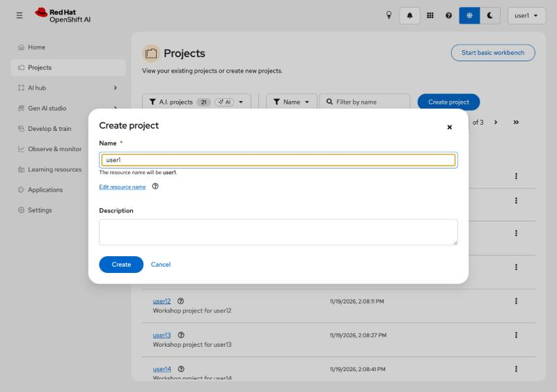

You land on your project `userN`, with tabs such as **Overview**, **Workbenches**, **Pipelines**, **Deployments** and **Connections**.

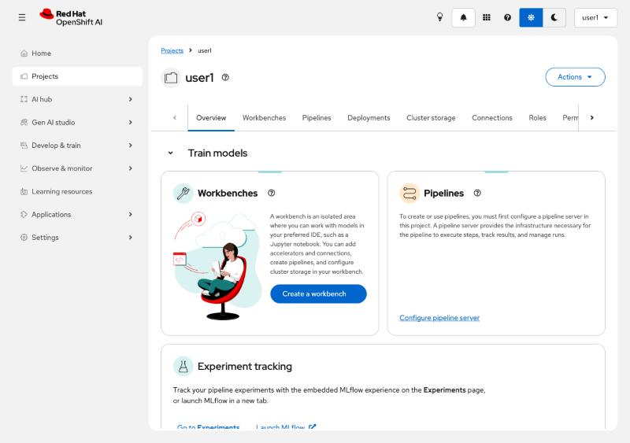

> **"Error creating project ... already exists"?** Someone (or you, in an earlier attempt) already created it. Click **Cancel**, type `userN` in the **Filter by name** box on the Projects page, and click your project to open it.

---

# Part 3: Deploy gemma-4-E4B-it (~20 min)

You'll deploy **gemma-4-E4B-it**, a small Gemma 4 model validated by Red Hat AI. It's packaged as a container image (a "modelcar") in the Red Hat registry, so you only need its address. No storage credentials are required.

You'll serve it as an **LLM inference service** on one GPU. That's the deployment method that can later be published as Models-as-a-Service (Part 5).

## Step 3.1: Understanding Hardware Profiles (Instructor Demo)

> **This is a brief demo by your instructor.** Just watch.

A **hardware profile** defines the CPU, memory and GPU given to a deployment. It also carries the node selector and tolerations that let pods run on GPU nodes.

**What the instructor will show:**

- **Settings > Environment setup > Hardware profiles** in the dashboard
- The pre-created `gpu-profile`, which includes:
  - The GPU resource (`nvidia.com/gpu`)
  - A node selector for GPU nodes
  - Tolerations for GPU node taints


> You don't create or change hardware profiles. You only **select** `gpu-profile` when you deploy.

## Step 3.2: Open the Deploy Wizard from Your Project

1. In your project `userN`, click the **Deployments** tab
2. Click **"Deploy model"**

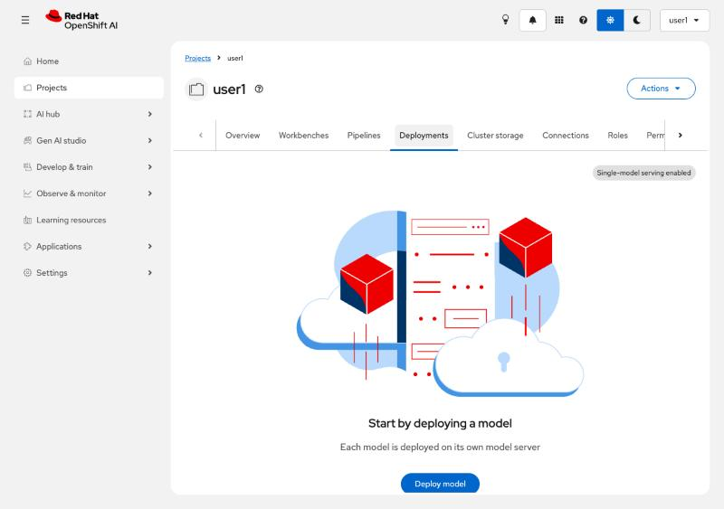

The wizard has four steps: **Model details**, **Model deployment**, **Advanced settings** and **Review**. The left sidebar now highlights **AI hub > Models**. That's normal: the wizard still deploys into your project.

> **Left the wizard by accident?** Go back to **Projects > userN > Deployments** and click **Deploy model** again. Nothing is created until the last step.

## Step 3.3: Wizard Step 1: Model Details

| Field | What to Select/Enter |
|-------|---------------------|
| **Model location** | `URI` |
| **URI** | `oci://registry.redhat.io/rhai/modelcar-redhatai-gemma-4-e4b-it:3.0` (copy it from here) |
| **Create a connection to this location** | Leave **checked** |
| **Name** (of the connection) | `gemma-4-e4b-it` |
| **Model type** | `Generative AI model (Example, LLM)` |

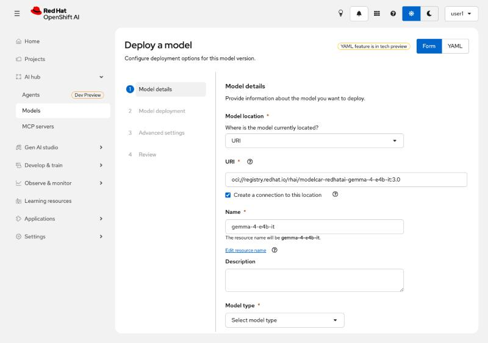

> **Tip:** Copy the URI with the copy button or triple-click it. A missing character here is the most common reason a deployment never starts.

Click **"Next"**.

## Step 3.4: Wizard Step 2: Model Deployment

The **Project** field already shows `userN`. Fill in the rest:

| Field | What to Select/Enter |
|-------|---------------------|
| **Model deployment name** | `gemma-4-e4b-it` (all lowercase). You'll see this name again in Parts 5 to 7. |
| **Deployment method** | **LLM inference service** (pre-selected). Leave it. *Inference service* can't be published as MaaS. |
| **Hardware profile** | `gpu-profile` |
| **Accelerator configuration** | **Manual selection** (pre-selected; *Automatic* is greyed out). Pick **vLLM NVIDIA CUDA GPU LLMInferenceServiceConfig Single Node**. **Read the warning below first.** |
| **Replica count** | `1` |

> [!CAUTION]
> **Most common mistake: pick `Single Node`, NOT `Single Node P/D`.**
>
> Open the **Accelerator configuration** dropdown and type `Single Node` in its search box. You get **two options with almost the same name**:
>
> | Option | |
> |--------|---|
> | vLLM NVIDIA CUDA GPU LLMInferenceServiceConfig Single Node **P/D (Prefill/Decode)** | ❌ **Wrong.** Don't pick it |
> | vLLM NVIDIA CUDA GPU LLMInferenceServiceConfig **Single Node** | ✅ **Correct.** The name **ends** in `Single Node` |
>
> The wrong one is listed **first**, so read the **end** of the name before you click. If you pick P/D, the wizard creates a second `-prefill` pod that gets no GPU and crashes, and your model **never becomes Ready**. See [Troubleshooting](#model-never-ready-a--prefill-pod-keeps-crashing) if that happens.

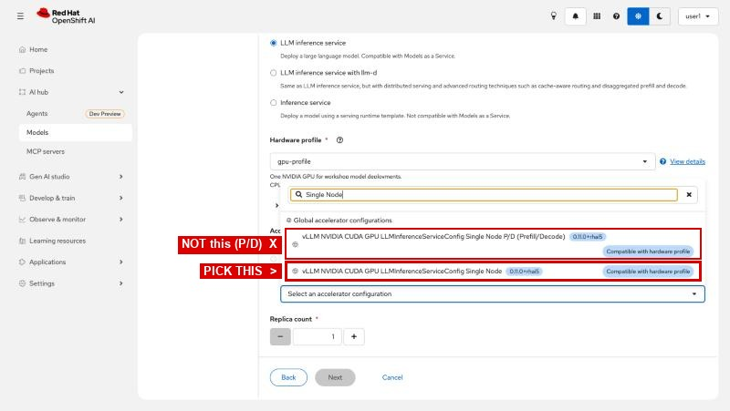

After you pick it, the field shows the name ending in **Single Node**:

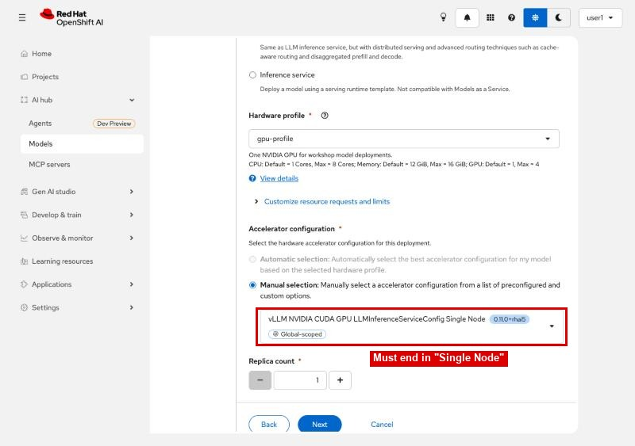

> **Why single node and one replica?** gemma-4-E4B-it fits comfortably on one GPU. Spreading one small model across several GPUs or nodes would only add overhead, so every participant gets one GPU.

Click **"Next"**.

## Step 3.5: Wizard Step 3: Advanced Settings

This page decides **who can reach your model and how**. For now you'll keep it simple and private to your project. You'll come back to this page in Part 5.

| Setting | What to Do |
|---------|-----------|
| **Add as AI asset endpoint** | **Check it** (makes the model available in the Playground) |
| **Use case** (appears after you check the box above) | Type `chat` |
| **Publish as MaaS** | **Leave unchecked** for now |
| **Gateway** | Select `openshift-ai-inference \| openshift-ingress` (the only option) |
| **Require token authentication** | **Uncheck it** (it starts checked). A yellow security warning appears; that's expected for now. |
| **Add custom runtime arguments** | **Check it**, then replace the example text with the arguments below |

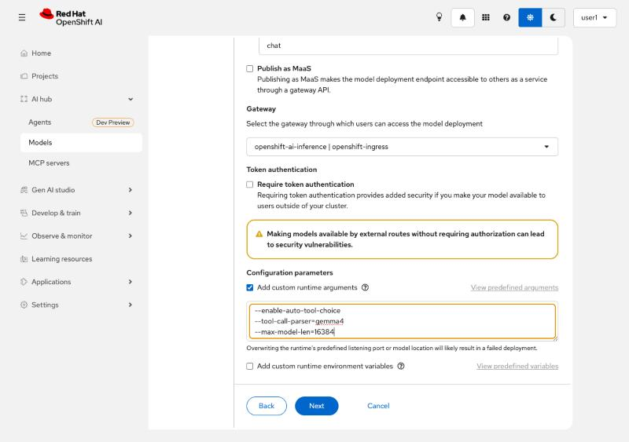

Enter each argument on its own line:

```
--enable-auto-tool-choice
--tool-call-parser=gemma4
--max-model-len=16384
```

**What these arguments do:**

| Argument | Purpose |
|----------|---------|
| `--enable-auto-tool-choice` | Lets the model decide when to call a tool (needed for MCP in Part 4) |
| `--tool-call-parser=gemma4` | Tells vLLM how to read Gemma 4's tool-call output |
| `--max-model-len=16384` | Caps the context window at 16K tokens, so the KV cache fits in GPU memory |

> **Out of GPU memory?** If the deployment fails with a CUDA out-of-memory error, edit it and change the last argument to `--max-model-len=8192`.

> **Why no token authentication yet?** In RHOAI 3.5.3, the Playground can't call a model deployment that requires a token. You'll secure the model properly in Parts 5 and 6, where MaaS API keys take over.

Other model families use other tool-call parsers, for example `hermes` (Qwen), `llama3_json` (Llama) and `mistral` (Mistral).

Click **"Next"**.

## Step 3.6: Wizard Step 4: Review and Deploy

Check the summary:

- **Model deployment name:** gemma-4-e4b-it
- **Hardware profile:** gpu-profile
- **Accelerator configuration:** vLLM NVIDIA CUDA GPU LLMInferenceServiceConfig Single Node (if it says **P/D (Prefill/Decode)**, click **Back** and fix it now)
- **Replicas:** 1
- **AI asset endpoint:** Yes, use case `chat`
- **Token authentication:** No
- **Additional runtime arguments:** 3
- **MaaS endpoint:** No

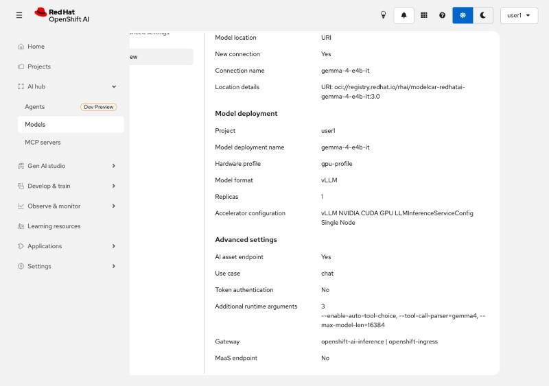

Scroll down and click **"Deploy model"**.

## Step 3.7: Wait for the Model to Be Ready

You land on your project's **Deployments** tab. The status shows **Pending**, then **Starting**, while the GPU node pulls the model image and vLLM loads the weights.

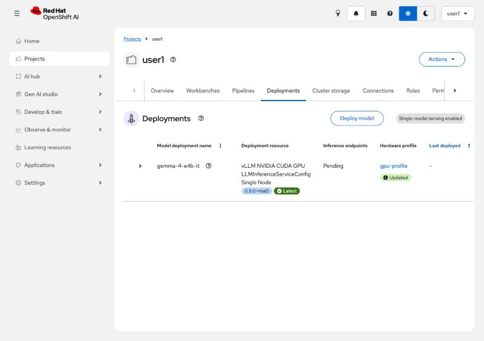

| Status | What It Means |
|--------|---------------|
| **Pending** | Waiting for a GPU node to be assigned |
| **Starting** | The image is being pulled and the model is loading |
| **Ready** / **Started** | The model is serving requests |
| **Failed** | Something went wrong (see [Troubleshooting](#troubleshooting)) |

> This takes **3 to 5 minutes** when the image is already cached on the node. The model image is about 16 GB, so the very first pull on a node can take 10 to 15 minutes. A good moment to stretch!

---

# Part 4: Try the Model in the AI Playground (~20 min)

The **AI Playground** is the chat interface built into the dashboard. You'll use it for plain chat, then let the model call cluster tools through an **MCP server**, then ground its answers in a document (**RAG**).

## Step 4.1: Find Your AI Asset Endpoint

Because you checked **Add as AI asset endpoint**, your model is already listed for the Playground.

1. Click **Gen AI studio > AI asset endpoints**
2. Make sure your project, `userN`, is selected in the **Project** dropdown
3. Your model `gemma-4-e4b-it` appears with use case `chat` and status **Ready**

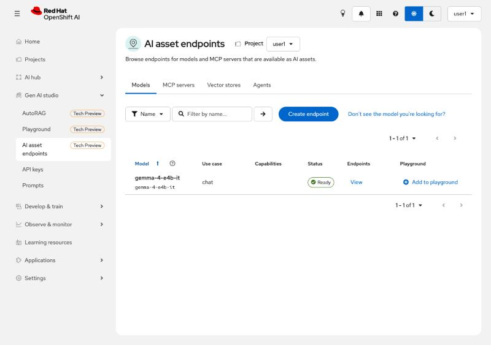

4. *(Optional)* Click **View** in the **Endpoints** column to see the URLs your model is served on: an external URL on the inference gateway and an internal cluster URL

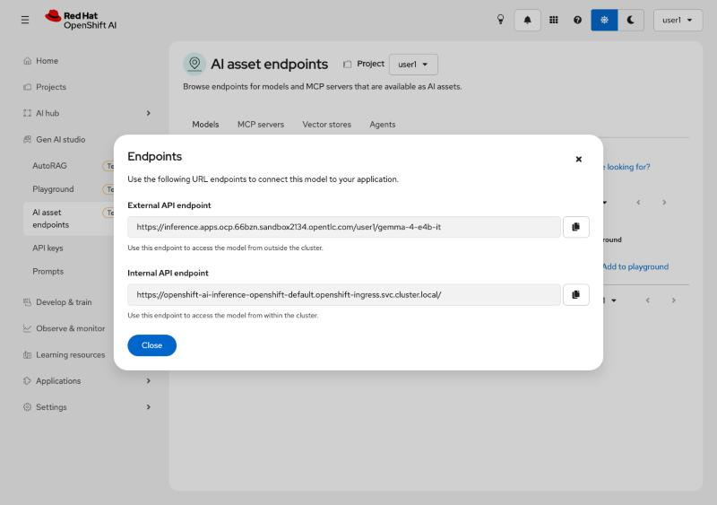

## Step 4.2: Add the Model to the Playground

1. Click **"Add to playground"** in your model's row
2. In **Configure playground**, keep your model checked
3. Click **"Create"**

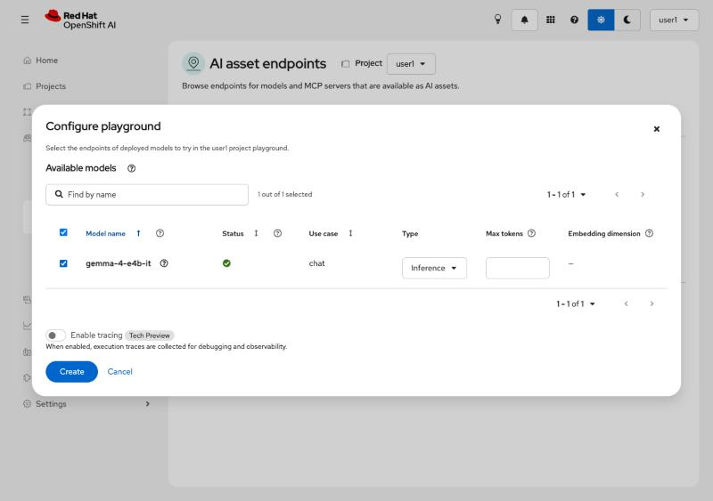

You'll see **Creating playground**. The dashboard sets up a Playground for your project, which takes about a minute, and then opens it for you (**Gen AI studio > Playground**). The **Settings** side panel is already open on the right.

> **Tip:** if your screen is narrow, collapse the left navigation with the **☰** icon (top left) to give the Playground more room. The side panel tabs (**Model, Prompt, Knowledge, MCP, Guardrails**) scroll with the **‹ ›** arrows.

## Step 4.3: Chat

Type a message and press Enter. Try:

```
In two sentences, what is Red Hat OpenShift AI?
```

```
Write a haiku about Kubernetes.
```

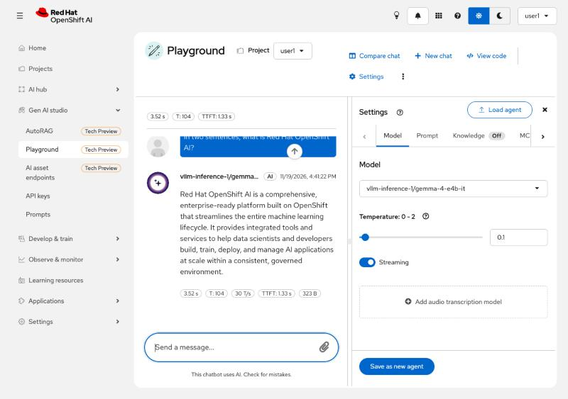

Under each answer you'll see the response time, the number of tokens (**T**), tokens per second, and the time to first token (**TTFT**).

> **Try the settings:** in the side panel (click **Settings**, top right, if you closed it), on the **Model** tab you can change **Temperature**. On the **Prompt** tab you can set a system prompt, for example: `You explain technical concepts with a real-world analogy.`

## Step 4.4: Let the Model Use Tools (MCP)

**MCP (Model Context Protocol)** is an open standard that lets a model call external tools. Your instructor runs a shared, read-only **OpenShift MCP Server** that can list pods, deployments, events and other cluster resources.

1. In the Playground side panel, open the **MCP** tab
2. Check the box next to **OpenShift-MCP-Server**. If a lock icon appears in the **Auth** column, click it
3. You'll see **Connection successful** with 12 tools active. Click **"Save"**

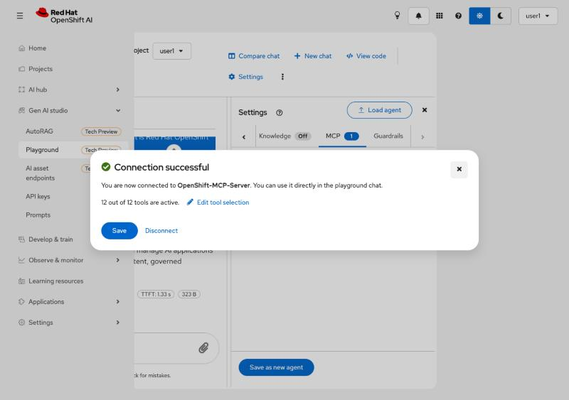

4. Ask questions that need live cluster data:

```
What pods are running in the userN namespace?
```

```
Show me the recent events in the userN namespace.
```

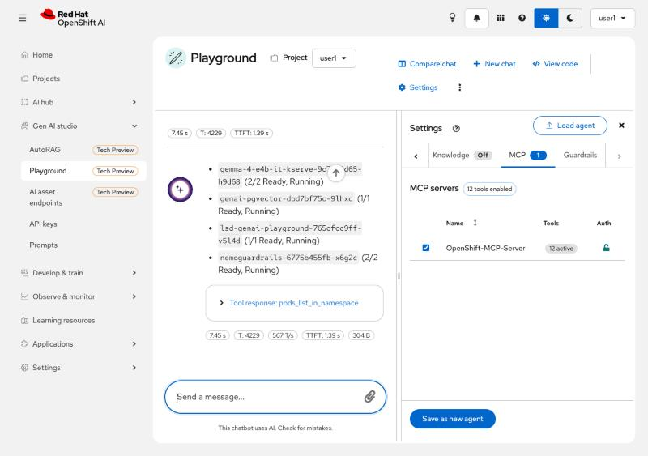

Expand **Tool response** under the answer to see the raw data the model received, for example from `pods_list_in_namespace`.

**What happened:**

```
You ──▶ Playground ──▶ model decides it needs live data ──▶ tool call (pods_list_in_namespace)
                                                              │
        answer in plain language ◀── model ◀── result ◀── OpenShift MCP Server ◀─┘
```

This is the job of `--enable-auto-tool-choice` and `--tool-call-parser=gemma4` from Step 3.5.

## Step 4.5: Ground Answers in a Document (RAG)

**RAG (Retrieval-Augmented Generation)** retrieves the relevant parts of your documents and hands them to the model with your question. The model can then answer questions about things it was never trained on.

**First, turn MCP off.** With tools enabled, the model tends to reach for a tool instead of your document. On the **MCP** tab, uncheck **OpenShift-MCP-Server**.

You'll use a short, made-up company handbook. The model can't know these facts, so a correct answer must come from the document.

<details>
<summary><b>Get <code>acme-handbook.txt</code></b> (click to expand)</summary>

**Easiest:** open [`samples/acme-handbook.txt`](samples/acme-handbook.txt) in the workshop repository on GitHub and click the **Download raw file** button (the **↓** icon above the file). It saves to your **Downloads** folder.

**Or create it yourself:** open a plain text editor (TextEdit on macOS: choose **Format > Make Plain Text** first; Notepad on Windows), paste this text, and save it as `acme-handbook.txt`:

```
Acme Robotics Employee Handbook (excerpt)

Remote work policy: Employees may work remotely up to 3 days per week. Fridays are designated "focus days" with no internal meetings.

Hardware refresh: Laptops are replaced every 36 months. Request a refresh through the IT portal ticket category "HW-REFRESH".

On-call: The platform team on-call rotation is 7 days long and hands over every Tuesday at 10:00 local time. On-call engineers receive a stipend of 150 USD per week.
```

</details>

1. Open the **Knowledge** tab in the side panel
2. Click **"Upload"** and choose `acme-handbook.txt` (look in **Downloads**)
3. In the **Upload files** dialog, keep the default chunk settings (800 / 400) and click **"Upload"**

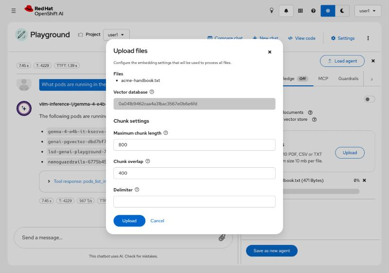

4. Wait for the green **Source uploaded** message. The file appears under **Uploaded files** and the **Knowledge** tab shows **On**
5. *(Recommended)* Click **"New chat"** (top) and confirm **Start a new chat session**, so the earlier MCP conversation doesn't distract the model. Your settings and uploaded file are kept
6. Ask:

```
How long is the platform team on-call rotation at Acme Robotics, and what is the weekly stipend?
```

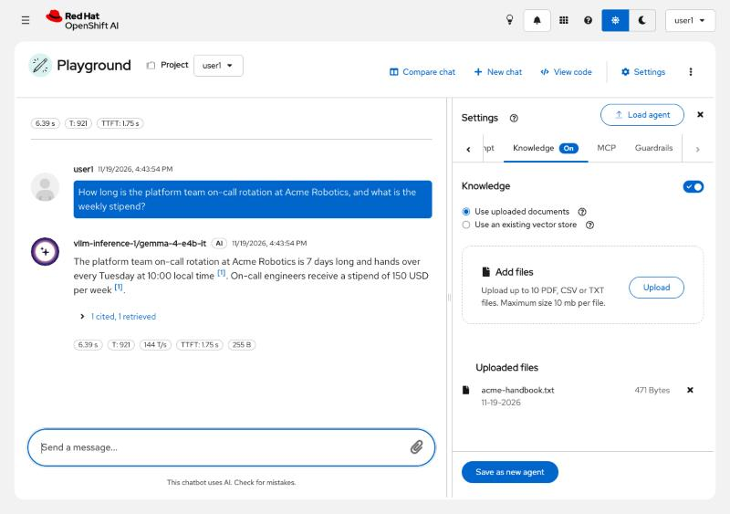

The answer should say **7 days** and **150 USD per week**, with citation markers. Expand **cited / retrieved** to see the chunk the answer came from.

Try a question the handbook can't answer, for example `What is Acme Robotics' parental leave policy?`, and see how the model handles it.

---

# Part 5: Publish Your Model as MaaS (~15 min)

So far your model is reachable only through your project's Playground and endpoints, with no access control. **Models-as-a-Service (MaaS)** turns a deployment into a governed service:

- One shared endpoint for every published model: `https://maas.apps.<cluster-domain>`
- Access only with an **API key**
- Each key belongs to a **subscription**, which decides **which models** it can use and **how many tokens per minute**

**How MaaS access works:**

```
API key (sk-oai-…)  ──belongs to──▶  subscription  ──lists──▶  models + token rate limit
                                          │
                                          └──owned by──▶ user groups
```

- A **subscription** lists models, a token limit for each model, and the groups allowed to use it
- An **API key** is created for exactly **one subscription**. It can call only that subscription's models, within its limits

Publishing takes two steps, one right after the other: turn on MaaS for your deployment (Step 5.1), then create a subscription that includes your model (Step 5.2). Your MaaS endpoint appears once both are done. You don't need to redeploy anything.

## Step 5.1: Edit the Deployment

1. Go to **Projects > userN**, **Deployments** tab
2. Click the **kebab menu (⋮)** at the end of your model's row and choose **"Edit"**
3. Click **"Next"** until you reach **Advanced settings**
4. Check **"Publish as MaaS"**

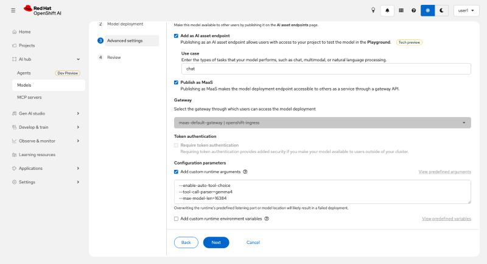

The **Gateway** switches to `maas-default-gateway | openshift-ingress` automatically. **Require token authentication** is greyed out because MaaS enforces API keys itself. Leave the custom runtime arguments as they are.

5. Click **"Next"**, check the review page (**MaaS endpoint: Yes**), then click **"Update deployment"**

The model pods are **not restarted**. Only the route moves from the inference gateway to the MaaS gateway, so this takes seconds. Go straight on to Step 5.2.

## Step 5.2: Create Your Basic Subscription

Your instructor has already created one shared **premium subscription** as a placeholder, to show that several tiers can exist. It is intentionally empty (no models), so it shows a **Failed** status and you can't create keys for it. You'll create your own **basic subscription userN**.

1. Go to **Settings > MaaS governance** (the last item under **Settings** in the left menu)
2. Open the **Subscriptions** tab and click **"Create subscription"**


3. Fill in the form:

   | Field | What to Enter |
   |-------|---------------|
   | **Name** | `basic subscription userN` (the resource name becomes `basic-subscription-userN`) |
   | **Description** | optional |
   | **Priority** | `10` (the form starts at `0`; higher numbers take precedence when you belong to more than one subscription) |
   | **Groups** | `rhods-admins` |

4. Under **Models**, click **"Add models"**. In the dialog, click **"Add model"** in the row for **your** model (project `userN`, model ID `gemma-4-e4b-it`), then click **"Add models"**. The dialog lists only models published as MaaS: if yours is missing, go back to Step 5.1 and check that it saved

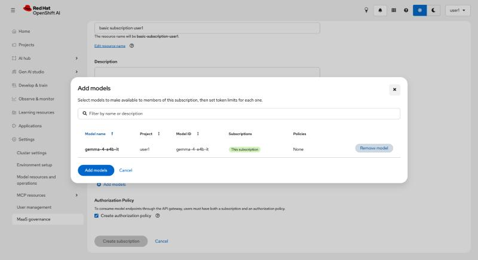

5. Click **"Add token limit"** in your model's row. Set it to **10000** tokens per **1** **minute** (the dialog starts at 1000 per hour), then click **"Save"**

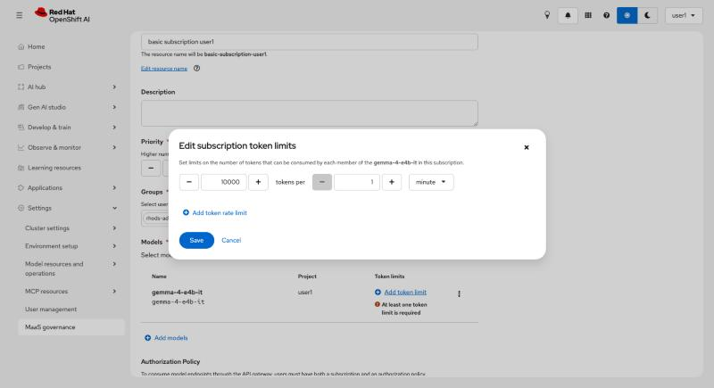

6. Keep **Create authorization policy** checked, then click **"Create subscription"**

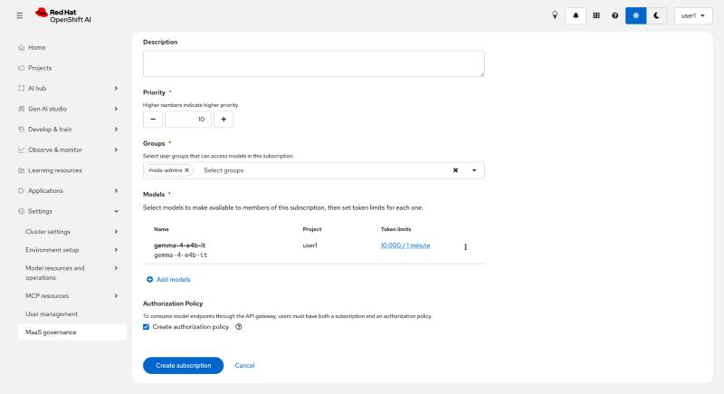

Your subscription appears in the list with status **Ready**. The instructor's `premium subscription` shows **Failed**. That's expected: it's an empty placeholder.

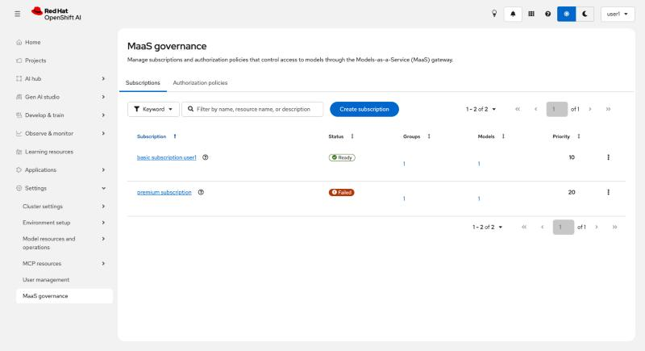

> **Why 10,000 tokens per minute?** The limit counts prompt **and** response tokens. Open WebUI (Part 7) also uses tokens in the background, for example to generate chat titles and follow-up suggestions. A very low limit such as 100 tokens per minute quickly runs out, and the requests are rejected with **429 Too Many Requests**. Open WebUI then shows an empty answer.

> **Heads-up:** in this workshop all attendees are in the same group (`rhods-admins`), so you can see everyone's subscriptions in dropdowns. Always pick **your own** `basic subscription userN`.

## Step 5.3: What Changed?

Go to **Gen AI studio > AI asset endpoints** (project `userN`). Within about a minute of creating your subscription, it shows **two rows**, both named `gemma-4-e4b-it`:

| Row | Use Case | What It Is |
|-----|----------|-----------|
| `gemma-4-e4b-it` | `chat` | The original AI asset entry. It still points at the **old** URL, which now returns **404** because the route moved |
| `gemma-4-e4b-it`, with `publishers/userN/models/gemma-4-e4b-it` underneath | `LLM` | The MaaS entry. This is the one to use from now on |

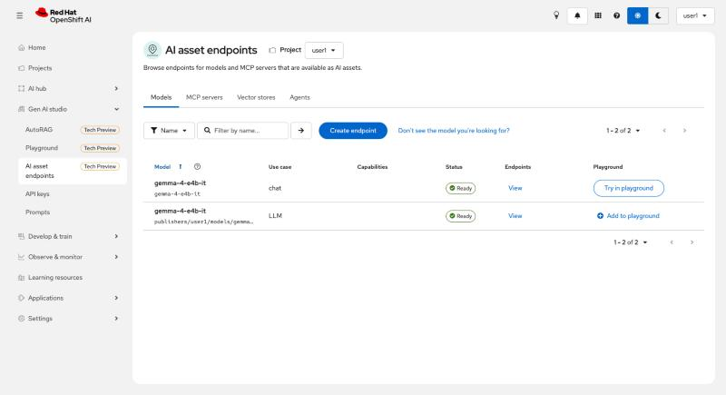

No **LLM** row after 2 minutes? Check that your subscription says **Ready** and lists **your** model (project `userN`), then reload the page.

Nothing was deleted. The dashboard simply lists the model once as a project AI asset and once as a MaaS model. The MaaS row has its own **Endpoints** dialog with the shared MaaS URL and a subscription picker.

> The Playground you created in Part 4 still points at the old URL, so it stops answering. You'll reconnect it through MaaS in Step 6.3.

If you call the MaaS URL now without a key, you get **401 Unauthorized**. You need an API key. That's Part 6.

---

# Part 6: API Keys and the Playground (~10 min)

Your model is published and in your subscription. Now look at its MaaS endpoint, create an API key for it, and use it from the Playground.

## Step 6.1: Look at the MaaS Endpoint

1. Go to **Gen AI studio > AI asset endpoints** (project `userN`)
2. In the row with use case **LLM** (`publishers/userN/models/gemma-4-e4b-it` underneath the name), click **View** in the **Endpoints** column

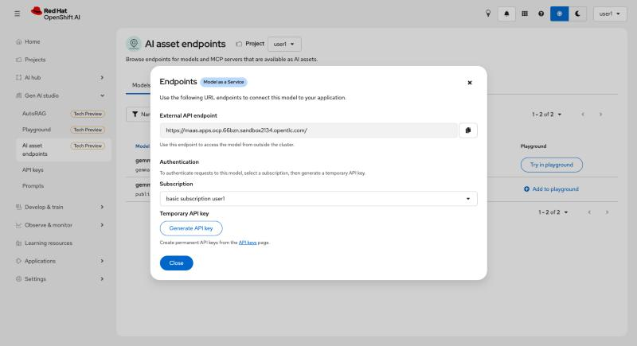

You see:

- **External API endpoint:** `https://maas.apps.<cluster-domain>/`. It is the same for every published model; the model ID in the request picks the model
- **Subscription:** choose `basic subscription userN`
- **Generate API key:** creates a **temporary** key that expires after 1 hour and isn't listed on the API keys page. Handy for a quick test

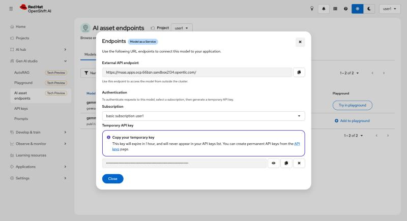

Click **"Close"**. For Open WebUI, you'll create a proper key.

## Step 6.2: Create an API Key

1. Go to **Gen AI studio > API keys**
2. Click **"Create API key"**
3. Fill in the form:

   | Field | What to Enter |
   |-------|---------------|
   | **Name** | `openwebui-userN` |
   | **Description** | `Key for Open WebUI` (optional) |
   | **Subscription** | start typing `basic`, then pick **your own** `basic subscription userN` |
   | **Expiration** | keep the default (1 day). It lasts past the end of the workshop |

   The **Models** list confirms which models the key can use, and their token limits.

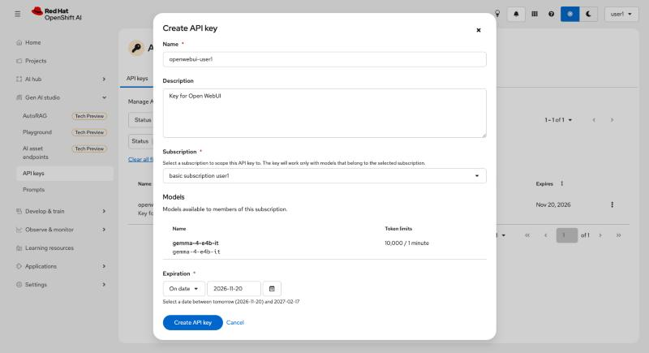

4. Click **"Create API key"**
5. **Copy the key now.** It starts with `sk-oai-` and is **shown only once**. Click the **copy icon** next to the key, then paste it somewhere safe, such as a local text file; you'll need it in Part 7. Then click **"Close"**

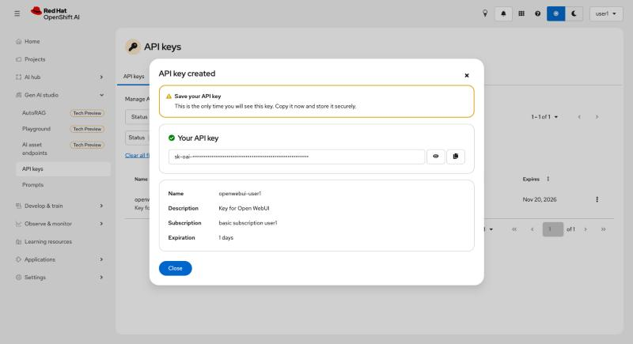

> Lost the key? You can't display it again. Delete it on the **API keys** page and create a new one.

## Step 6.3: Use MaaS from the Playground

Reconnect the Playground through MaaS, the same way other applications will reach the model:

1. Go to **Gen AI studio > AI asset endpoints** (project `userN`)
2. In the row with use case **LLM** (`publishers/userN/models/gemma-4-e4b-it` underneath the name), click **"Add to playground"**
3. In **Configure playground**, both rows are named `gemma-4-e4b-it`. Keep the row with use case **LLM** (the MaaS one) checked and **uncheck** the row with use case **chat** (the old endpoint)

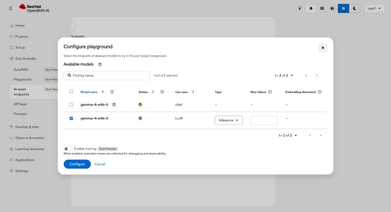

4. Click **"Configure"**. The Playground is re-created with the new model, which takes about a minute. When you see **"Playground created"**, click **"Go to playground"**
5. Click **Settings**. On the **Model** tab, the fields are already filled in. Check them:
   - **Model:** the `maas-vllm-inference-1/publishers/userN/models/…` entry
   - **Subscription:** `basic subscription userN`
6. Ask a question, for example `In one sentence, what is Models-as-a-Service?`

> The re-created Playground starts empty: the document you uploaded for RAG in Step 4.5 is gone. Upload it again if you want to repeat the RAG test through MaaS.

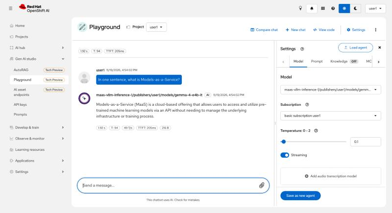

The Playground now calls your model through the MaaS gateway, with your subscription and its token limit.

## Step 6.4 (Optional): Call MaaS from the Command Line

Any OpenAI-compatible client can now use your model. In the Web Terminal (see Step 7.1), try:

```bash
export MAAS_URL=https://$(oc get gateway maas-default-gateway -n openshift-ingress -o jsonpath='{.spec.listeners[0].hostname}')
echo $MAAS_URL
export MAAS_KEY=<paste your sk-oai- key>
```

The first command reads the MaaS address from the cluster, so you don't need to type your cluster's domain. `echo` should print something like `https://maas.apps.<cluster-domain>`.

List the models your key can use:

```bash
curl -s $MAAS_URL/v1/models -H "Authorization: Bearer $MAAS_KEY"
```

Send a chat request:

```bash
curl -s $MAAS_URL/v1/chat/completions \
  -H "Authorization: Bearer $MAAS_KEY" \
  -H "Content-Type: application/json" \
  -d '{"model": "publishers/userN/models/gemma-4-e4b-it", "messages": [{"role": "user", "content": "Say hello in three languages."}], "max_tokens": 100}'
```

> **See a rate limit in action:** edit your subscription (**Settings > MaaS governance**), set the limit to `100` tokens per minute, and run the chat request a few times. After the limit is used up, MaaS answers **429 Too Many Requests**. Usage is counted after each response, so the request that crosses the limit still succeeds and the next one is blocked. **Set the limit back to 10000** before Part 7.

---

# Part 7: Connect Open WebUI to MaaS (~25 min)

**Open WebUI** is a self-hosted chat interface, similar to ChatGPT. You'll run it in your project and point it at MaaS with your API key, just like any other application would.

```
You (browser) ──▶ Open WebUI ──(sk-oai- key)──▶ MaaS gateway ──▶ your model (GPU)
```

## Step 7.1: Open the Web Terminal

Switch to the **OpenShift Console** (grid icon > **OpenShift Console**). If it asks you to log in, use the same `userN` as the dashboard. If a **Welcome** dialog offers a tour, click **Skip tour**.

Click the **`>_`** icon in the top-right masthead to open the Web Terminal. The first time, it shows **Initialize terminal**: click **Start** (if it asks for a project, pick `userN`). The terminal takes about 15 seconds to start. It comes with `oc`, `git` and `sed`, so you don't need any local tools.

> **New to the terminal?** You only need to copy and paste. Hover over each command block in this guide and click its copy icon. Click inside the terminal and paste with **Ctrl+Shift+V** (Windows/Linux) or **Cmd+V** (Mac), or right-click > **Paste**. Then press **Enter**. Run one block at a time and wait for the prompt (`$`) to come back before the next one.

## Step 7.2: Clone the Workshop Repository

```bash
git clone -b rhoai-3.5-maas-workshop https://github.com/cbtham/Red-Hat-AI-Workshop.git
```

```bash
cd Red-Hat-AI-Workshop
```

## Step 7.3: Set Your Namespace

Your project has the same name as your user, so the terminal can fill it in for you. The next commands use it to deploy into your project.

```bash
export NAMESPACE=$(oc whoami)
```

```bash
echo $NAMESPACE
```

It should print your own user, for example `user1`. If it doesn't, type it yourself, for example `export NAMESPACE=user1`.

## Step 7.4: Deploy Open WebUI

> **What this deploys (5 resources):**
> - **ConfigMap**: base configuration (no model connection; you'll add it yourself)
> - **PersistentVolumeClaim**: 2Gi of storage for Open WebUI data
> - **Deployment**: the Open WebUI container (v0.9.0)
> - **Service**: internal access on port 8080
> - **Route**: an external HTTPS URL for your browser

```bash
sed "s/\${NAMESPACE}/$NAMESPACE/g" manifests/open-webui.yaml | oc apply -f -
```

Wait for it to start:

```bash
oc rollout status deployment/open-webui -n $NAMESPACE --timeout=180s
```

It takes about a minute. You should see five lines ending in `created`, then `successfully rolled out`:

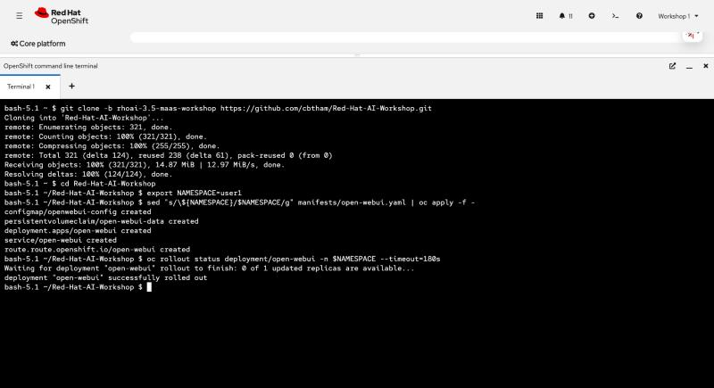

## Step 7.5: Open Open WebUI

In the OpenShift AI dashboard, go to **Applications > Enabled**. Find the **Open WebUI** tile whose description starts with **your** `userN:` (everyone's tiles are listed) and click **Open application**:

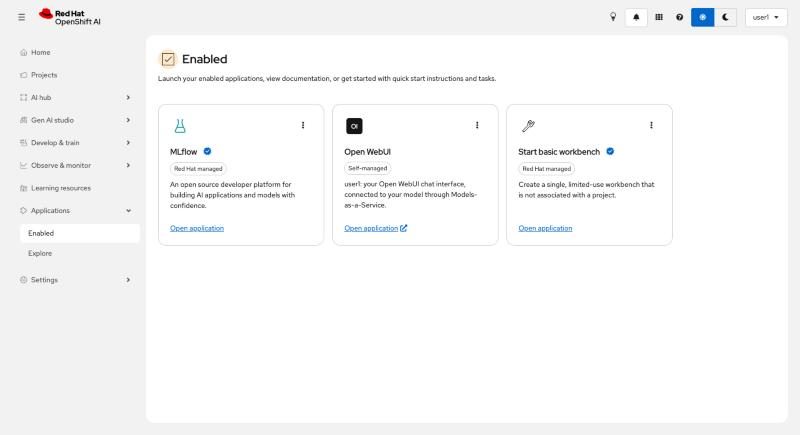

Or get the URL in the terminal:

```bash
echo "https://$(oc get route open-webui -n $NAMESPACE -o jsonpath='{.spec.host}')"
```

Open the URL in a new browser tab. Authentication is disabled for the workshop, so you go straight to the chat page. If a **What's New** dialog appears, click **"Okay, Let's Go!"**.

> **Open only your own Open WebUI.** Without a login, anyone who opens your URL can chat with your API key, and everything you configure there is shared. Don't upload anything confidential.

## Step 7.6: Add the MaaS Connection with Your API Key

First, get the MaaS base URL for Open WebUI. It's the MaaS endpoint from Step 6.1 plus `/v1`:

```bash
echo "https://$(oc get gateway maas-default-gateway -n openshift-ingress -o jsonpath='{.spec.listeners[0].hostname}')/v1"
```

It looks like `https://maas.apps.<cluster-domain>/v1`, with your workshop cluster's domain filled in. Copy the whole line.

Now, in Open WebUI:

1. Click the **profile icon** (bottom-left corner), then **"Admin Panel"**
2. Click **"Settings"**, then **"Connections"**
3. Under **OpenAI API**, on the **"Manage OpenAI API Connections"** row, click **"+"** (Add Connection) at the far right
4. Fill in:

   | Field | Value |
   |-------|-------|
   | **URL** | the URL the command above printed (it ends in `/v1`) |
   | **Auth** | `Bearer`, then paste your **`sk-oai-` API key** from Step 6.2 into the field next to it |
   | **Model IDs** | leave empty (Open WebUI lists every model your key can use) |

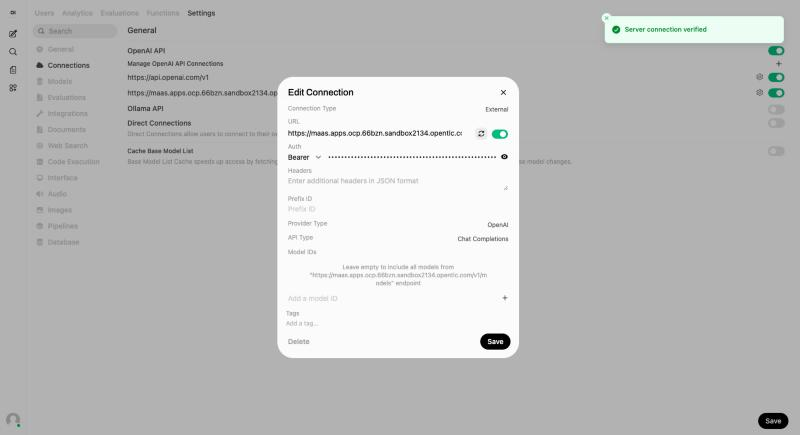

5. Click the **Verify** icon (circular arrows) next to the URL. You should see **"Server connection verified"**
   - **"OpenAI: Network Problem"** usually means the key is wrong or empty, not the network. Copy the key again (click the eye icon to check it starts with `sk-oai-`), paste it, and verify again
6. Click **"Save"** in the dialog, then **"Save"** at the bottom right of the page
7. Open WebUI comes with a connection to `https://api.openai.com/v1` that has no key. Turn its toggle **off** and click **"Save"** again, so only your MaaS connection is used

That's all it takes to plug an application into MaaS: a base URL and an API key.

## Step 7.7: Give the Model a Friendly Name

Open WebUI shows the model by its MaaS ID, `publishers/userN/models/gemma-4-e4b-it`. Give it a shorter display name:

1. In **Admin Panel > Settings**, click **"Models"**
2. Click the **pencil icon** next to `publishers/userN/models/gemma-4-e4b-it`
3. Click the large model name at the top and replace it with `redhataigemma4`
4. Scroll to the bottom of the page and click **"Save & Update"**. You should see **"Model updated successfully"**

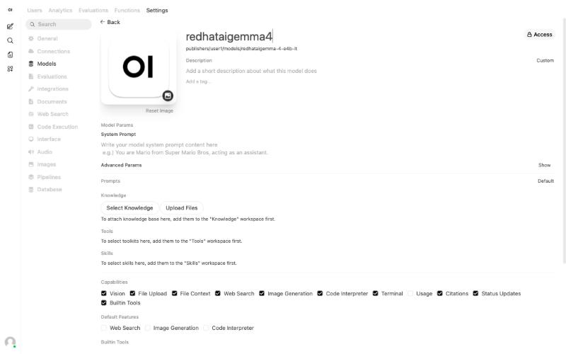

This changes only what Open WebUI displays. Requests still go to MaaS with the full model ID.

## Step 7.8: Chat

1. Click **"New Chat"** (the pencil-and-paper icon at the top of the left sidebar)
2. Check that **`redhataigemma4`** is selected at the top left. It's your only model, so it's usually already selected
3. Try:

```
What is Kubernetes? Answer in three bullet points.
```

```
Write a Python function that returns the first n Fibonacci numbers.
```

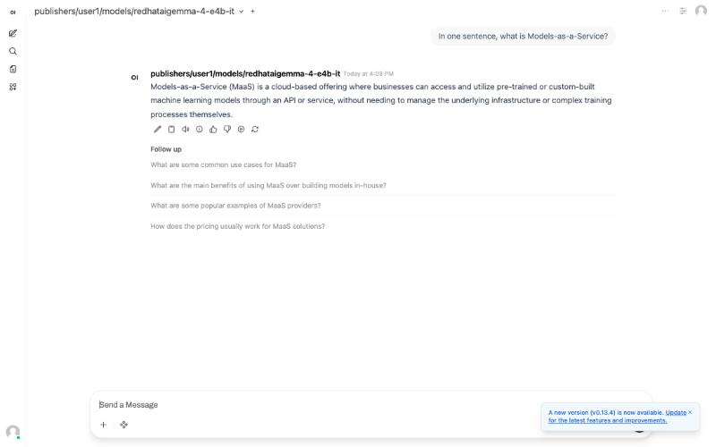

Every request goes through MaaS and counts against your subscription's token limit.

## Step 7.9: RAG in Open WebUI

Open WebUI has RAG built in. It splits your document into chunks, embeds them with a small local model, stores them in a vector database and retrieves the relevant chunks for each question.

1. Start a **New Chat** with `redhataigemma4`
2. Click **"+"** in the message box and choose **"Upload Files"**
3. Select `acme-handbook.txt` (from Step 4.5)
4. Ask:

```
How long is the platform team on-call rotation at Acme Robotics, and what is the weekly stipend?
```

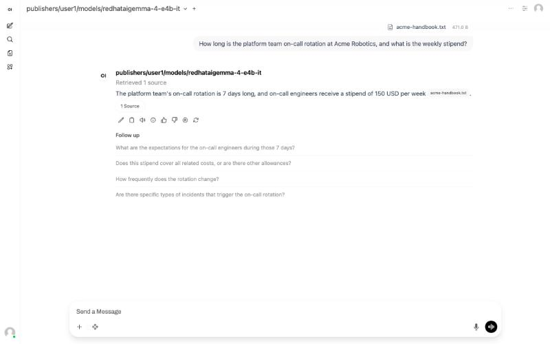

The answer shows **Retrieved 1 source** and a citation chip. Click the chip to see the passage it used.

> **Bonus:** the **"+"** menu also has **"Attach Webpage"**. Paste any public URL and ask questions about that page.

---

# Congratulations!

You've completed the hands-on part of the workshop.

## What You Accomplished

| Task | Status |
|------|--------|
| Logged into OpenShift AI and created a project | Done |
| Deployed gemma-4-E4B-it as an LLM inference service on one GPU | Done |
| Chatted, called cluster tools via MCP, and used RAG in the AI Playground | Done |
| Published the same deployment as Models-as-a-Service | Done |
| Created a subscription with a token limit, and an API key | Done |
| Connected Open WebUI to MaaS with your key, and used chat and RAG | Done |

---

# Part 8 (Optional): Observability (~10 min)

> **Instructor-led demo.** Participants watch while the instructor walks through the dashboards.

1. Open the OpenShift Console
2. Go to **Observe > Dashboards**
3. Show the **vLLM** dashboard: request latency, tokens per second, queue length
4. Show the **NVIDIA DCGM Exporter** dashboard: GPU utilization, memory, temperature
5. In the dashboard, show **Observe & monitor** for per-deployment metrics
6. Discuss how these metrics help with capacity planning, and how MaaS token limits protect shared GPUs

> The instructor setup turns on user workload monitoring and GPU metrics, so step 5 works on any workshop cluster. The GPU and vLLM dashboards in steps 3 and 4 are added separately. See [Appendix A](#appendix-a-instructor-setup-checklist), step 9.

---

# Troubleshooting

## "Model stuck in Starting or Pending"

**Cause:** no free GPU, or the first pull of the 16 GB model image is still running.

**Fix:**

- Check the pods: `oc get pods -n userN`. If a pod is **Pending**, there's no free GPU. Ask your instructor
- If the pod is **ContainerCreating** or **Init**, the image is still being pulled. Give it a few more minutes

## "Model shows Failed" or the pod keeps restarting

1. Look at the logs:

   ```bash
   oc logs -n userN -l app.kubernetes.io/name=gemma-4-e4b-it -c main --tail=50
   ```

2. Common causes:
   - **CUDA out of memory:** edit the deployment and change `--max-model-len=16384` to `--max-model-len=8192`
   - **Wrong hardware profile:** make sure you selected `gpu-profile`

## Model never Ready: a `-prefill` pod keeps crashing

**Cause:** in Step 3.4 you picked the accelerator configuration ending in **Single Node P/D (Prefill/Decode)** instead of the one ending in **Single Node**. You can recognise it from the pods:

```bash
oc get pods -n userN
```

A pod named `gemma-4-e4b-it-kserve-prefill-…` is in **CrashLoopBackOff**, and its log ends with `RuntimeError: Failed to infer device type`. The prefill pod gets no GPU, so it can't start.

**Fix:** the quickest reliable fix is to delete the deployment and deploy again:

1. **Projects > userN > Deployments**, kebab menu (⋮) on `gemma-4-e4b-it` > **Delete**, then confirm
2. Repeat Part 3. In Step 3.4 pick the option whose name **ends** in **Single Node** (see the screenshot there), and check it again on the review page

Stuck? Ask your instructor, who can also fix it in place.

## "No Gateways found" in the deploy wizard

The inference gateway for non-MaaS deployments is missing. Ask your instructor (see Appendix A, step 3).

## No MaaS (LLM) row, or no MaaS model to add to the Playground

**Cause:** you published the model as MaaS (Step 5.1) but haven't created your subscription yet, or it doesn't include your model. MaaS lists a model only once a subscription includes it.

**Fix:** do **[Step 5.2](#step-52-create-your-basic-subscription)**. Then check:

- **Settings > MaaS governance > Subscriptions** shows `basic subscription userN` with status **Ready**
- Its **Models** column shows 1. Click the subscription and check that the model is **yours** (project `userN`), not another attendee's
- In the deployment's review page (kebab menu ⋮ > **Edit**, click **Next** to the end), **MaaS endpoint** says **Yes**

Then reload **Gen AI studio > AI asset endpoints**. The **LLM** row shows up within about a minute.

## Playground: "Server error" or no answer after Part 5

The original Playground entry still points at the old URL, which returns 404 after publishing as MaaS. Finish Part 5 (publish **and** subscription), then follow **Step 6.3** to add the MaaS row to the Playground.

## Playground: RAG ignores the document

Turn **off** the OpenShift-MCP-Server on the **MCP** tab. With tools enabled, the model may try a tool instead of reading the document. Also check that the **Knowledge** tab shows **On**.

## Playground: MCP tools not called

- Check that the server is checked on the **MCP** tab and shows 12 tools
- Be explicit: `Use the available tools to list the pods in the userN namespace.`
- Check that `--enable-auto-tool-choice` and `--tool-call-parser=gemma4` are in the deployment's runtime arguments

## MaaS returns 401 Unauthorized

- The API key is missing, mistyped, expired or deleted. Create a new one in **Gen AI studio > API keys**
- In Open WebUI, a 401 shows up as **"OpenAI: Network Problem"** when you click **Verify**. Paste the key again
- The header must be `Authorization: Bearer sk-oai-…`

## MaaS returns 429, or Open WebUI shows an empty answer

Your subscription's token limit is used up. Wait a minute, or raise the limit to **10000 tokens per 1 minute** in **Settings > MaaS governance > Subscriptions**.

## Open WebUI shows no models

1. In **Admin Panel > Settings > Connections**, open your connection and click **Verify**
2. Check that the URL ends in **`/v1`** and starts with `https://maas.`
3. Check that the key's subscription includes your model: `/v1/models` lists only the models of the key's subscription
4. Check the model is ready: `oc get llminferenceservice -n userN`

## Still stuck?

Raise your hand! The instructors are here to help.

---

# Quick Reference Card

## Your Info

- **Username:** `_______`
- **Password:** `________`
- **Project name:** `user____`
- **Subscription:** `basic subscription user____`

## Key Names and URLs

| Item | Value |
|------|-------|
| RHOAI Dashboard | The link your instructor gave you |
| MaaS endpoint (for apps) | `https://maas.apps.<cluster-domain>/v1` |
| Model ID through MaaS | `publishers/userN/models/gemma-4-e4b-it` |
| Model resource name | `gemma-4-e4b-it` |
| Open WebUI display name | `redhataigemma4` |

`<cluster-domain>` is different for every workshop, so don't copy it from this guide. The commands below print the real addresses for your cluster.

## Key Terminal Commands

```bash
# Set your namespace
export NAMESPACE=$(oc whoami)

# Check your login and project
oc whoami
oc project $NAMESPACE

# Model status (LLM inference service deployments are LLMInferenceServices)
oc get llminferenceservice -n $NAMESPACE

# Pods in your project
oc get pods -n $NAMESPACE

# Model logs
oc logs -n $NAMESPACE -l app.kubernetes.io/name=gemma-4-e4b-it -c main --tail=50

# Deploy Open WebUI
sed "s/\${NAMESPACE}/$NAMESPACE/g" manifests/open-webui.yaml | oc apply -f -

# Open WebUI URL
echo "https://$(oc get route open-webui -n $NAMESPACE -o jsonpath='{.spec.host}')"

# MaaS base URL for Open WebUI
echo "https://$(oc get gateway maas-default-gateway -n openshift-ingress -o jsonpath='{.spec.listeners[0].hostname}')/v1"

# All of the above in one go (Open WebUI URL, MaaS base URL, model ID)
./show-urls.sh

# GPU nodes
oc get nodes -l nvidia.com/gpu.present=true

# Clean up (deletes everything in your project)
oc delete project $NAMESPACE
```

---

# Appendix A: Instructor Setup Checklist

This section is for workshop instructors.

> **Setting up a cluster? Follow [ENVIRONMENT-SETUP.md](ENVIRONMENT-SETUP.md).** You order an RHDP environment and run one script, which does every step below for any number of attendees:
>
> ```bash
> bash manifests/instructor/setup-workshop.sh --check        # read-only: what's ready, what's missing
> bash manifests/instructor/setup-workshop.sh --users <N>    # set up for user1..userN
> ```
>
> This appendix explains what each piece is, why the workshop needs it, and how to do or check it by hand.

> **GPU capacity:** every participant deploys their own model on **one GPU**. For N participants you need N free GPUs, plus spare capacity if you want a demo model. Check before the workshop:
>
> ```bash
> oc get nodes -l nvidia.com/gpu.present=true -o custom-columns=NODE:.metadata.name,GPUS:.status.allocatable.nvidia\\.com/gpu
> ```
>
> Without enough GPUs, deployments stay **Pending**. If you're short, pair participants up (one deployment per pair).

## 1. Install RHOAI 3.5 with Models-as-a-Service

The workshop needs RHOAI 3.5.x **with** MaaS and its dependency, Red Hat Connectivity Link (RHCL), which provides the API-key auth and the token rate limiting.

On an RHDP environment, the setup script's platform step does this. It runs `field-source-enable-all-features-35.sh` and `field-source-setup-maas-35.sh` from [rhoai-field-source-setup-guide](https://github.com/jingggg-wenn/rhoai-field-source-setup-guide). On another cluster, install it any way you like, for example with the [RHOAI Toolkit](https://github.com/gymnatics/RHOAI-Toolkit) installer, run **without** `--skip-rhcl` and `--skip-maas`.

Then check that MaaS is up:

```bash
oc get gateway -n openshift-ingress                 # expect maas-default-gateway
oc get pods -n redhat-ai-gateway-infra              # MaaS API
oc get namespace models-as-a-service
```

## 2. Users and groups

Add every workshop user to the **`rhods-admins`** group. Attendees need it to open **Settings > MaaS governance** and create their own subscription. The setup script's first step does this with `setup_workshop_users_rbac.sh`, which also gives each user `cluster-admin`. By hand:

```bash
for i in $(seq 1 <N>); do oc adm groups add-users rhods-admins user$i; done
```

> All attendees share `rhods-admins`, so everyone can see everyone's subscriptions and projects. The guide tells them to always pick `basic subscription userN` and their own project.

**Projects:** attendees create their own project `userN` in Part 2. Don't pre-create projects. If your installer created `user1`…`userN` projects, delete them (empty ones only):

```bash
for i in $(seq 1 <N>); do oc delete project user$i --ignore-not-found; done
```

Check that authenticated users may create projects (the default on OpenShift):

```bash
oc get clusterrolebinding self-provisioners -o jsonpath='{.subjects[*].name}'   # expect system:authenticated:oauth
```

MaaS permissions come from the `rhods-admins` group, not from the project, so self-created projects work with MaaS subscriptions and API keys.

## 3. Inference gateway for non-MaaS deployments

In Part 3, attendees deploy with **Publish as MaaS** unchecked. KServe then routes the model through the gateway `openshift-ingress/openshift-ai-inference`. Without it, the wizard shows "No Gateways found". The manifest also adds an in-cluster HTTPS listener that the Playground needs:

```bash
export APPS_DOMAIN=$(oc get ingresscontroller default -n openshift-ingress-operator -o jsonpath='{.status.domain}')
export CERT_SECRET=$(oc get ingresscontroller default -n openshift-ingress-operator -o jsonpath='{.spec.defaultCertificate.name}')
sed -e "s/\${APPS_DOMAIN}/$APPS_DOMAIN/g" -e "s/\${CERT_SECRET}/${CERT_SECRET:-router-certs-default}/g" \
  manifests/instructor/inference-gateway.yaml | oc apply -f -
oc get gateway openshift-ai-inference -n openshift-ingress
```

Both values are read from the cluster: its apps domain and the certificate its routes already use.

## 4. GPU hardware profile

Create a hardware profile named **`gpu-profile`** with 1 GPU, at least 12 GiB memory, and the GPU node selector and tolerations. The setup script's GPU step creates it with `gpu_machineset_hardwareprofiles.sh`, together with a `g6.2xlarge` (NVIDIA L4) GPU MachineSet, and then scales that MachineSet to one node per attendee. Check it:

```bash
oc get hardwareprofile gpu-profile -n redhat-ods-applications
```

Attendees only **select** this profile. Give it a generic display name (no GPU model such as "(L4)"), so the guide matches every cluster:

```bash
oc annotate hardwareprofile gpu-profile -n redhat-ods-applications --overwrite \
  opendatahub.io/display-name=gpu-profile \
  opendatahub.io/description="One NVIDIA GPU for workshop model deployments."
```

## 5. Web Terminal operator

```bash
oc apply -f manifests/instructor/web-terminal-subscription.yaml
```

Optional: start a terminal for each attendee ahead of time, so **`>_`** opens straight to a prompt in Step 7.1 with no **Initialize terminal** step. Attendees are cluster admins, so their terminals live in `openshift-terminal`. The script creates each one as that attendee (impersonation), because the console finds a terminal by its creator's user ID. It also raises the idle timeout from 15m to 4h:

```bash
bash manifests/instructor/web-terminals.sh <N>
```

A user ID exists only after the attendee's first login, so the script skips anyone who hasn't logged in yet. Run it again once everyone has logged in (Part 1). Attendees who already have a terminal are left alone. Remove the terminals after the workshop with `bash manifests/instructor/web-terminals.sh <N> delete`.

## 6. Shared OpenShift MCP Server

One read-only MCP server for everyone, registered for the Playground's **MCP** tab as **OpenShift-MCP-Server**:

```bash
oc apply -f manifests/instructor/mcp-server-shared.yaml
oc get pods -n workshop-mcp
```

If the ConfigMap `gen-ai-aa-mcp-servers` in `redhat-ods-applications` already has other entries, add the `OpenShift-MCP-Server` key instead of replacing the ConfigMap.

## 6a. Open WebUI tiles in Applications > Enabled

One **Open WebUI** tile per attendee, so they can open their Open WebUI from the dashboard in Step 7.5. Each tile links to `https://open-webui-userN.<apps domain>`. Its description starts with `userN:`, because every tile is visible to every user. Pass the number of attendees:

```bash
bash manifests/instructor/open-webui-tiles.sh <N>
```

This is an instructor step, not an attendee step. The tiles live in the shared `redhat-ods-applications` namespace and change the dashboard for everyone. Even though attendees have cluster-admin, one wrong edit there would break the dashboard for the whole room.

The dashboard shows the tiles within about 1 to 2 minutes. A tile's link works once that attendee has finished Step 7.4. Remove them after the workshop with `bash manifests/instructor/open-webui-tiles.sh <N> delete`.

This follows Red Hat's [Adding an application to the dashboard](https://docs.redhat.com/en/documentation/red_hat_openshift_ai_self-managed/3.4/html/managing_openshift_ai/managing-applications-that-show-in-the-dashboard). It uses an `OdhApplication` with `spec.enable.validationConfigMap`, and the script creates that ConfigMap with `validation_result: "true"`, so attendees don't need to click **Enable** on the Explore page. The script sets `spec.endpoint` instead of `route`/`routeNamespace`: in RHOAI 3.5.3 the dashboard looks up `route` in its own namespace first. The default `spec.dashboardConfig.enablement: true` is required.

## 7. "premium subscription" placeholder

One shared, intentionally empty subscription. It shows as **Failed** and can't be used for keys. That is expected; it only shows attendees that more tiers can exist:

```bash
oc apply -f manifests/instructor/premium-subscription.yaml
oc get maassubscription -n models-as-a-service
```

## 8. Pre-pull the model image

The gemma-4-E4B-it image is about 16 GB and took about 13 minutes on its first pull in testing. [`manifests/instructor/model-prepull.yaml`](manifests/instructor/model-prepull.yaml) is a DaemonSet that pulls it, and the vLLM runtime image, onto every GPU node (including ones that join later) and keeps them cached. Its pods use no GPU. The setup script applies it; by hand:

```bash
T=$(oc get llminferenceserviceconfig -n redhat-ods-applications -o name | grep 'kserve-config-llm-template$' | head -1)
export VLLM_IMAGE=$(oc get -n redhat-ods-applications "$T" -o jsonpath='{.spec.template.containers[?(@.name=="main")].image}')
export MODEL_IMAGE=registry.redhat.io/rhai/modelcar-redhatai-gemma-4-e4b-it:3.0
sed -e "s|\${VLLM_IMAGE}|$VLLM_IMAGE|g" -e "s|\${MODEL_IMAGE}|$MODEL_IMAGE|g" \
  manifests/instructor/model-prepull.yaml | oc apply -f -
oc get pods -n workshop-prepull -o wide     # Running = both images cached on that node
```

Remove it after the workshop with `oc delete project workshop-prepull`.

## 9. Observability (optional Part 8)

The setup script's platform step turns on user workload monitoring and the GPU Operator's DCGM metrics, so per-deployment metrics in the dashboard work. The console dashboards are not installed:

- **GPU dashboard:** follow NVIDIA's [Enabling the GPU Monitoring Dashboard](https://docs.nvidia.com/datacenter/cloud-native/openshift/latest/enable-gpu-monitoring-dashboard.html)
- **vLLM dashboard:** not included. Skip that step of Part 8, or add your own before the workshop

## 10. Dry run

Walk through the guide once as `user1`, then clean `user1` up so the real attendee starts fresh. The steps and the cleanup order are in [ENVIRONMENT-SETUP.md, Step 4](ENVIRONMENT-SETUP.md#step-4-dry-run).

## Known limitations (RHOAI 3.5.3)

- **Token authentication and the Playground:** a deployment with **Require token authentication** can't be used from the Playground. That's why Part 3 leaves it off and Parts 5 and 6 secure the model with MaaS instead
- **Two AI asset rows after publishing as MaaS:** the original row keeps pointing at the old URL (404). Attendees re-add the MaaS row to the Playground (Step 6.3)
- **Empty subscriptions** (like the premium placeholder) show as **Failed**

## Workshop Credentials Template

Provide each participant with the values below. `setup-workshop.sh --check` prints them for your cluster as the **attendee handout**:

| Field | Value |
|-------|-------|
| OpenShift AI Dashboard URL | From the handout (different for every cluster) |
| OpenShift Console URL | From the handout |
| Login provider | From the handout (`rhbk` on RHDP) |
| Username | `userN` |
| Password | The user password on your RHDP service page |
| User number (for project) | `N` |

---

**Reference:** [RHOAI 3.5 Documentation](https://docs.redhat.com/en/documentation/red_hat_openshift_ai_self-managed/3.5)
